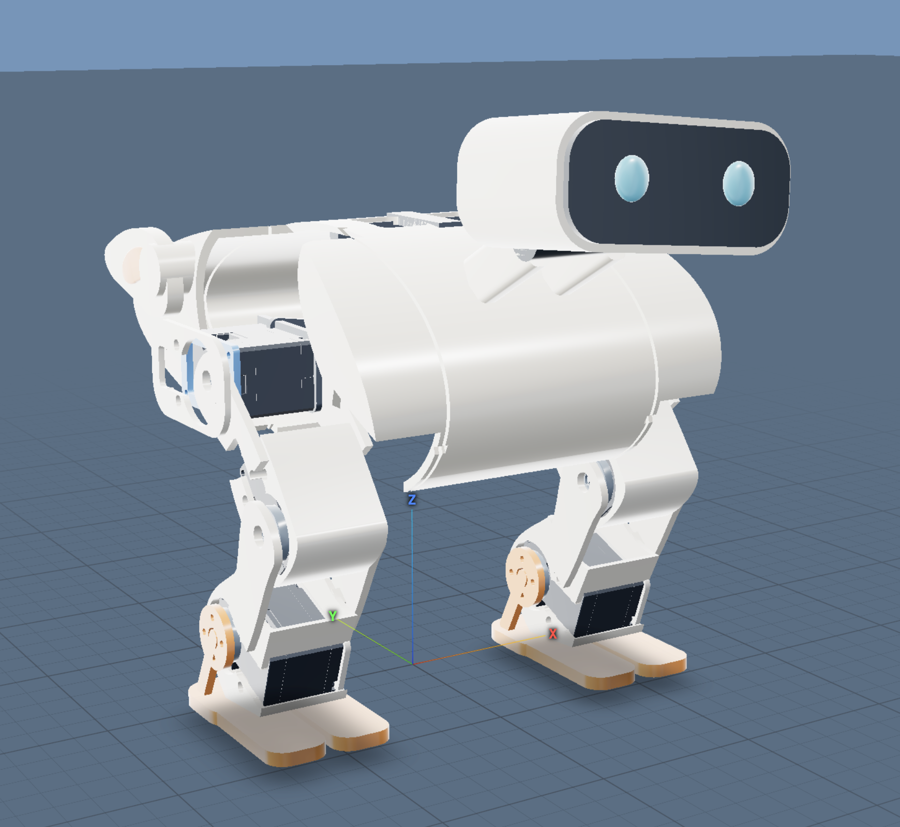
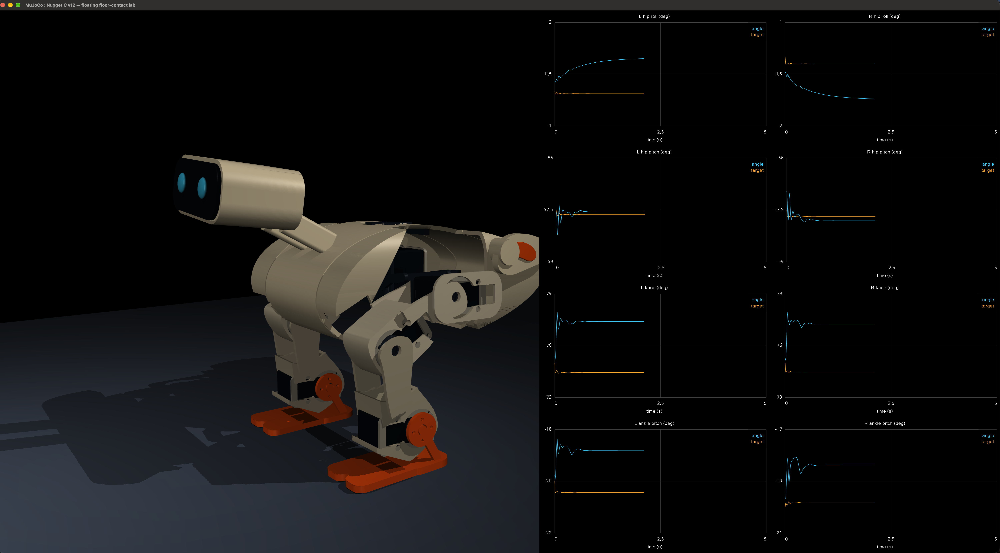

# Nugget

<p align="center">
  
</p>

## Quick blog

Robotics is getting accessible, so I took a side challenge of designing one.

Inspiration: All those cute robots. 
Goal: Make a chicken that runs as fast as possible. 
CAD: ForgeCAD + Codex + Eyes. 
Model and physics: MuJoCo. 
Learning Env: Gymnasium (for now). 
Brains: TBD. 

### Part 1: Design


### Part 2: Learning to stand still

<p align="center">
  
</p>

Here, I'm going simplest first - using more complex methods only when I truly saturate a simpler method's abilities. 

The first step was hooking up the MuJoCo model to create a custom `MujocoEnv`, `NuggetStandEnv`, that handles every step of the simulation and the reward calculation. The rough workflow is therefore:

```
reinforce.py: initialize policy NN that predicts joint means and stds
reinforce.py: initialize stand.py environment

For each rollout:
NuggetStandEnv -[state, reward, termination flags]-> reinforce.py 
reinforce.py -[action (joint targets relative to standing pose)] -> NuggetStandEnv

After 16 rollouts: average gradients and update the policy once.
```

The environment supports 
- a noisy reset of the joints and velocities (to prevent overfitting to sim)
- early episode termination (falling down - contact detection between body and ground)
- reward definition

The "stand still" reward is composed of several terms, so I pass a dict of all of them to the training so I can analyze the rollouts better.

```math
\begin{aligned}
r_t ={} &
\underbrace{\exp\!\left[-\left(\frac{h_t-h^*}{0.010\,\mathrm{m}}\right)^2\right]}_{\text{height}}
+ \underbrace{\exp\!\left[-\left(\frac{\theta_t}{20^\circ}\right)^2\right]}_{\text{upright}} \\
&- \underbrace{0.1\left(\frac{\lVert\mathbf{v}_{\mathrm{COM},xy,t}\rVert}{0.1\,\mathrm{m/s}}\right)^2}_{\text{horizontal motion}}
- \underbrace{20\,\mathbf{1}_{\mathrm{fall},t}}_{\text{fall penalty}}.
\end{aligned}
```

Here, $h_t$ is the whole-robot center-of-mass (COM) height and $h^*$ is its
height in the grounded reference standing pose. $\theta_t$ is the angle between
the torso's up axis and world vertical; the implementation uses radians, with
$20^\circ = \pi/9$. $\mathbf{v}_{\mathrm{COM},xy,t}$ is horizontal COM velocity,
including motion caused by the leg joints.

The fall indicator is 1 on the terminating step if a torso-attached collision
geometry touches the floor, COM height falls below 0.055 m, or torso tilt exceeds
60°. The penalty is applied once; reaching the episode time limit does not incur
it. Nonfinite observations terminate immediately with reward 0.

This reward is evaluated every 0.01 s. Its maximum is 2 per step: reference
height, upright torso, no horizontal motion and no fall. Episode return is the
sum of these step rewards. 


### Next steps:
Curriculum learning to add nudges, instead of just environment noise

## Dev guide

### Quickstart

Install [uv](https://docs.astral.sh/uv/getting-started/installation/), then run
from this folder:

```sh
uv sync --locked
uv run nugget-viewer
```

Use `uv run nugget-viewer --bench` for the pinned joint explorer. In the
viewer: **6–9** select poses, **F6** switches pose/physics mode, **F8** resets,
and **F9/F10** toggle center of mass/collision shapes. On Mac, hold **Fn** if needed.

Run checks with `uv run python -m unittest discover -s tests -v`.
Watch a policy in the training environment (Space pauses, R repeats the reset):

```sh
uv run nugget-viewer --policy zero --no-reset-noise
uv run nugget-viewer --policy zero
uv run nugget-viewer --policy runs/stand_reinforce/<run>/checkpoints/episode_000100.pt
```

Checkpoint playback uses mean actions; add `--sample` for training-time policy noise.
Live playback shows joint angle (blue) and target (orange) plots; **P** toggles them.
Add `--headless` to print one episode's result without opening a window.
Physics and mass properties are approximate.

Train with grouped rollouts: four randomized starting states, four rollouts per
state, then one policy update averaging all 16 episodes. Action noise is sampled
independently on every step. Each batch uses new starting states.

```sh
uv run python -m nugget.training.reinforce --batch-size 16 --rollouts-per-reset 4
```

Use `--rollouts-per-reset 1` for a different reset state every episode.

### Repo structure

```text
cad/                   ForgeCAD source snapshots
models/                MJCF models, meshes and provenance
src/nugget/            Robot conventions, manual poses and interactive viewer
  envs/                Gymnasium/mjlab placeholders
  training/            Training-runner placeholders
  evaluation/          Evaluation placeholders
configs/               Empty task and training configuration files
scripts/               Current model-building script
tests/                 Model import and physics checks
docs/images/           Renders and README images
runs/                  Training outputs (ignored by Git)
```

The current model uses a saved CAD export and a local conversion script;
native ForgeCAD MJCF export is still to be tested.
